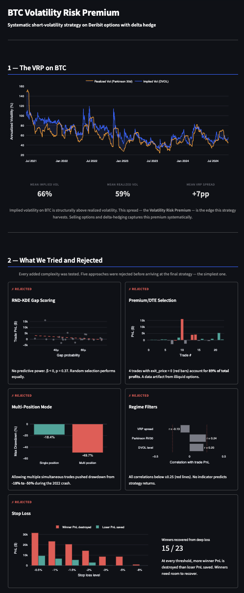

# BTC Volatility Risk Premium — Systematic Harvesting Strategy

Systematic short-volatility strategy on BTC options (Deribit) with delta hedge via quarterly futures. IS Sharpe 1.75 (p=0.007) through the 2022 bear market; cross-asset validation on SPY options (147 trades, 14 years).

## Results

All Sharpe ratios are trade-level annualized and **invariant to position sizing** — the three risk configurations (Conservative, Moderate, Aggressive) scale return and drawdown linearly but do not affect risk-adjusted performance.

|                  | BTC In-Sample       | BTC Out-of-Sample  | SPY (cross-asset)   |
|------------------|---------------------|--------------------|---------------------|
| Period           | Jun 2021 – Sep 2023 | Oct 2023 – Sep 2024| Jan 2010 – Dec 2023 |
| Trades           | 35                  | 10                 | 147                 |
| Win rate         | 65.7%               | 60.0%              | 66.0%               |
| Sharpe           | 1.75                | 1.53               | 0.79                |
| Return (vega=50) | +37.0%              | +14.3%             | +9.1%               |
| Max DD (MTM)     | -18.4%              | -4.5%              | -2.3%               |
| t-test (p-value) | 0.007               | 0.091              | —                   |

Bootstrap 95% CI for IS Sharpe: [0.72, 2.74]. The IS period includes the 2022 bear market (BTC -55% in a single quarter). Sharpe is invariant across all three sizing configurations (1.75).

## Research Journey

This strategy is the result of a systematic elimination process. Every added complexity was tested and rejected if it didn't survive scrutiny:

1. **RND-KDE gap scoring** — built a full Risk-Neutral Density pipeline with rolling KDE. Demeaned regression showed β < 0, p=0.37. Random option selection performs equally well. Rejected.

2. **Premium/DTE scoring** — score = bid × spot / DTE. Discovered that 116% of total profits came from trades with bid=0 at exit — a data artifact where worthless options counted as "free to close." Without these, the strategy was negative. Rejected as primary strategy.

3. **Multi-position mode** — allowing multiple simultaneous trades. IS drawdown reached -49.7% (MTM), unacceptable for any realistic capital allocation. Rejected.

4. **Regime filters** — tested 5 indicators (DVOL level, DVOL momentum, VRP spread, funding rate, realized vol ratio). None showed predictive power for strategy returns. Not implemented.

5. **Stop loss** — analyzed all 35 IS trades: 15 of 23 winners recovered from drawdowns that would have triggered any reasonable stop. At every level tested, more winner PnL is destroyed than loser PnL saved. Not implemented.

6. **Final: Top Vega** — select the highest-vega option each day. The simplest possible approach, validated by the failure of every attempt at complexity.

## Strategy

- **Selection**: highest |vega| option daily, OTM only, |delta| ≤ 0.50, DTE 30–90
- **Execution**: T+1 (signal at close, entry next day at bid)
- **Hedge**: delta-neutral via Deribit quarterly futures, rebalanced daily
- **Exit**: 50% of premium captured or DTE ≤ 5
- **Sizing**: capital-based vega target = (equity × risk%) / (worst_loss_per_vega × buffer)

| Config       | Risk/trade | Buffer | Initial vega target | IS Return | IS Max DD |
|--------------|------------|--------|---------------------|-----------|-----------|
| Conservative | 1%         | 2.0×   | 9.1                 | +6.9%     | -3.9%     |
| Moderate     | 2%         | 1.5×   | 24.3                | +19.3%    | -10.3%    |
| Aggressive   | 3%         | 1.0×   | 54.6                | +47.8%    | -22.6%    |

## Why BTC and Not SPY

The VRP exists on both assets — option-only win rate is 82% on both BTC and SPY. But the hedge economics diverge:

- **BTC**: high realized vol → gamma rebalancing generates mechanical profit (+$771/trade in flat markets). The hedge is net positive.
- **SPY**: low realized vol → gamma rebalancing insufficient to cover daily rebalancing costs (-$518/trade in flat markets). The hedge eats the premium.

BTC's structurally wide implied-realized spread (IV ~69% vs SPY ~16%) makes it the only market where the strategy is economically viable after hedging costs.

## Dashboards

Three interactive Streamlit dashboards accompany the research:

**Research narrative** — guided walkthrough of the VRP edge and the approaches rejected along the way.



**Backtest explorer** — equity curves, robustness heatmaps, and statistical validation across IS/OOS/Full periods and three sizing configurations.


**Live paper trading monitor** — real-time position, Greeks, hedge state, and PnL on Deribit testnet.


## Project Structure

```
├── src/                    Core library (backtest engine, scoring, live trading)
├── scripts/                Entry points (backtest, sensitivity, dashboard data, paper trader)
├── notebooks/              Research notebooks with full output (5 notebooks)
├── tests/                  Statistical validation scripts
├── dashboard/              Streamlit dashboards (story, backtest, live monitor)
├── dashboard_data/         Pre-generated dashboard data (included in repo)
├── config/                 Centralized parameters (params.yaml)
├── tools/                  Data download utilities (Deribit, optionsdx)
└── docs/                   Strategy documentation
```

## Setup

```bash
git clone https://github.com/your-username/btc-vrp-strategy.git
cd btc-vrp-strategy

pip install -r requirements.txt

# Add Deribit API credentials (needed only for live trading)
cp .env.example .env

# Run backtest (requires data in Data/ — see Data section)
python scripts/run_backtest.py

# Launch dashboard (works immediately with pre-generated data)
streamlit run dashboard/dashboard.py
streamlit run dashboard/story.py       # narrative research story
streamlit run dashboard/live.py        # live paper trading monitor
```

## Live Paper Trading

The strategy runs in paper trading on Deribit testnet via cron (every 4 hours):

```bash
python scripts/run_trader.py --once     # single cycle
python scripts/run_trader.py            # daemon mode
python scripts/run_trader.py --status   # check positions
```

Current configuration: Top Vega only, capital-based moderate sizing (2% risk, 1.5× buffer), quarterly futures hedge.

## Data

Raw option data is not included in the repository (~5 GB). Sources:

- **BTC options**: Deribit historical data. Monthly EOD files in `Data/Options_Historical_DataSet/` (Jun 2021 – Sep 2024)
- **BTC spot/futures/funding**: downloaded via scripts in `tools/` from Deribit and Binance APIs
- **SPY options** (cross-asset validation): [optionsDX](https://www.optionsdx.com/) EOD data (Jan 2010 – Dec 2023), placed in `SPY Options/extracted/`

The `dashboard_data/` directory contains pre-generated results and is included in the repo — the dashboard works without raw data.

## Disclaimer

This project is for educational and research purposes only. It is not financial advice. Past performance does not guarantee future results. Options trading involves substantial risk of loss. The authors are not responsible for any trading decisions made based on this research.
