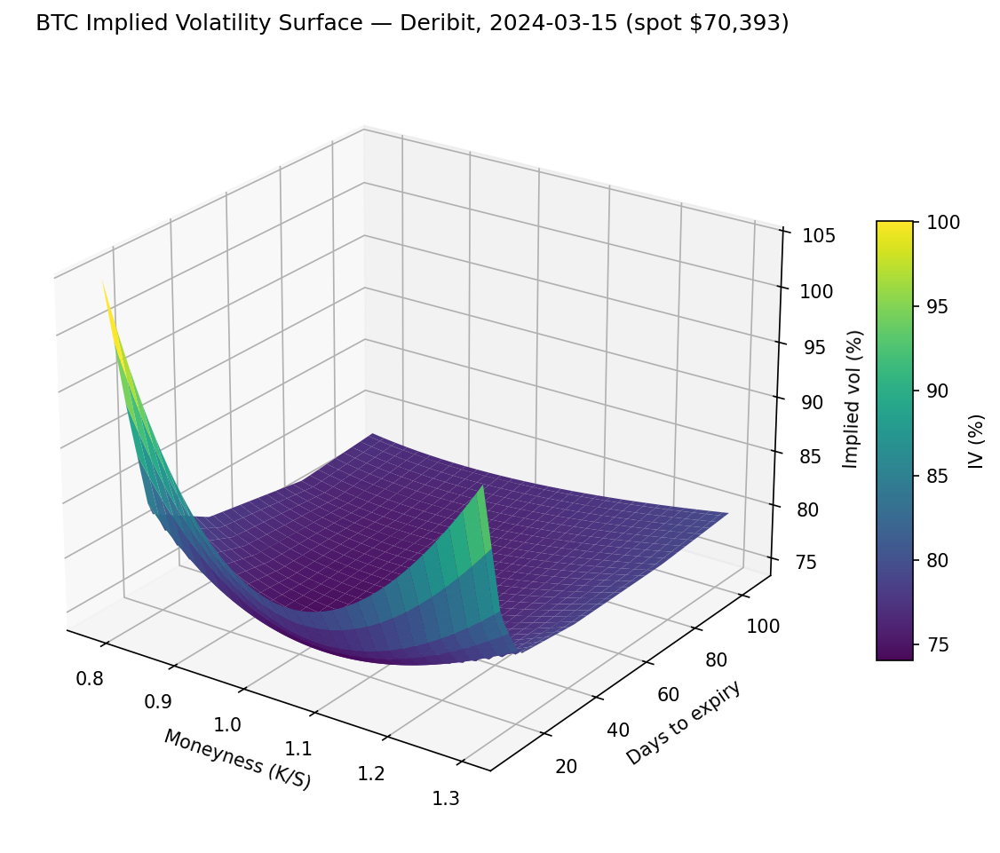
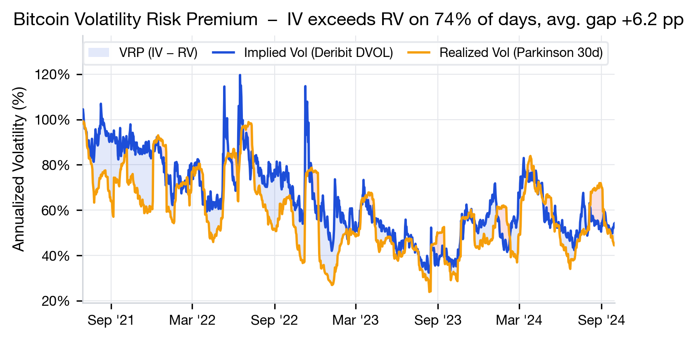
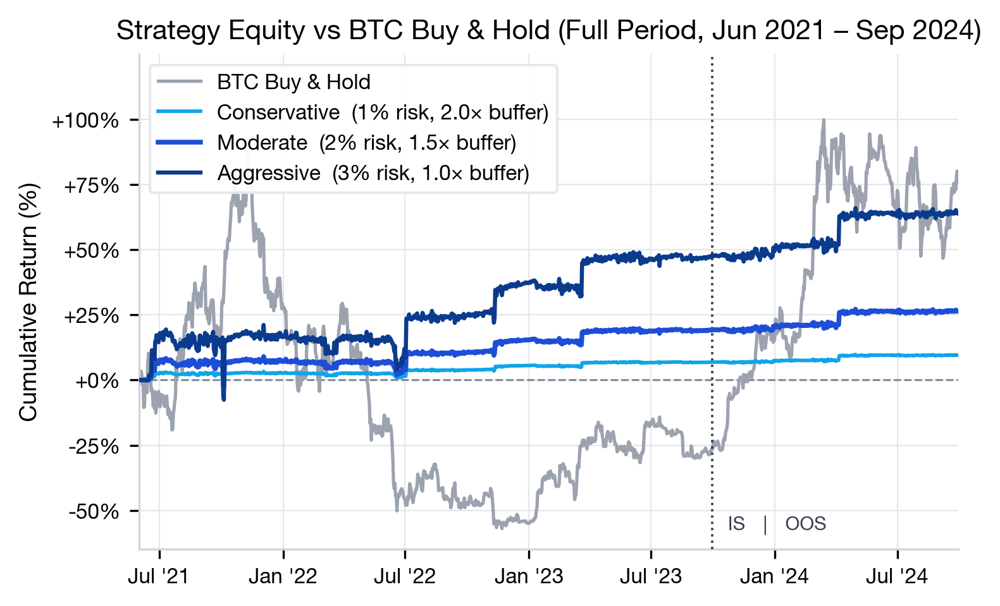
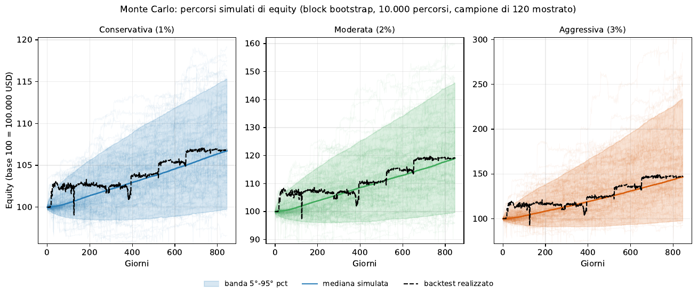
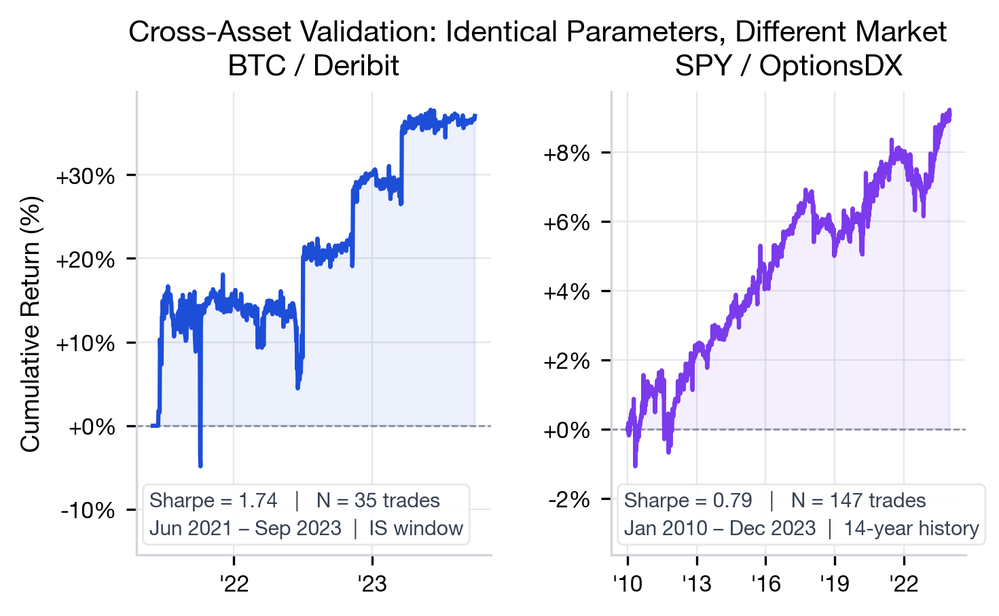
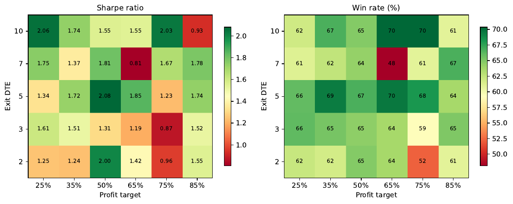
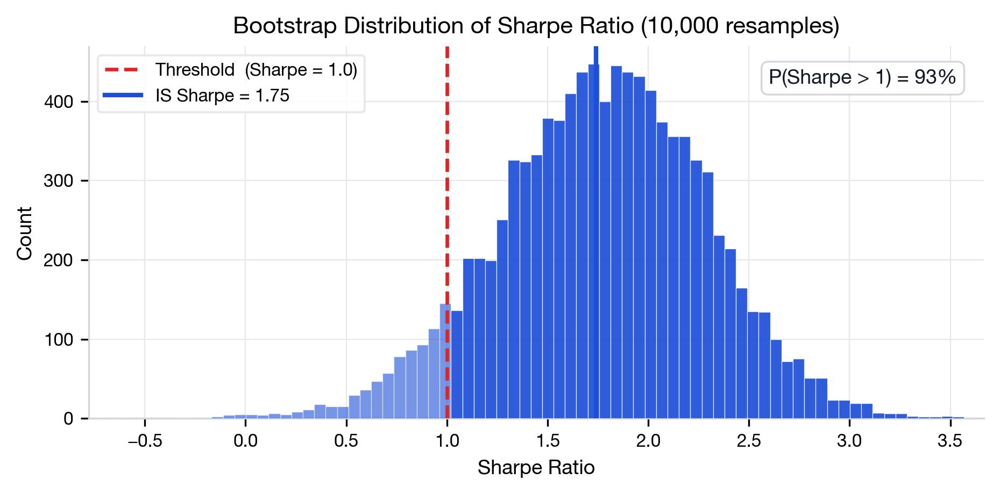
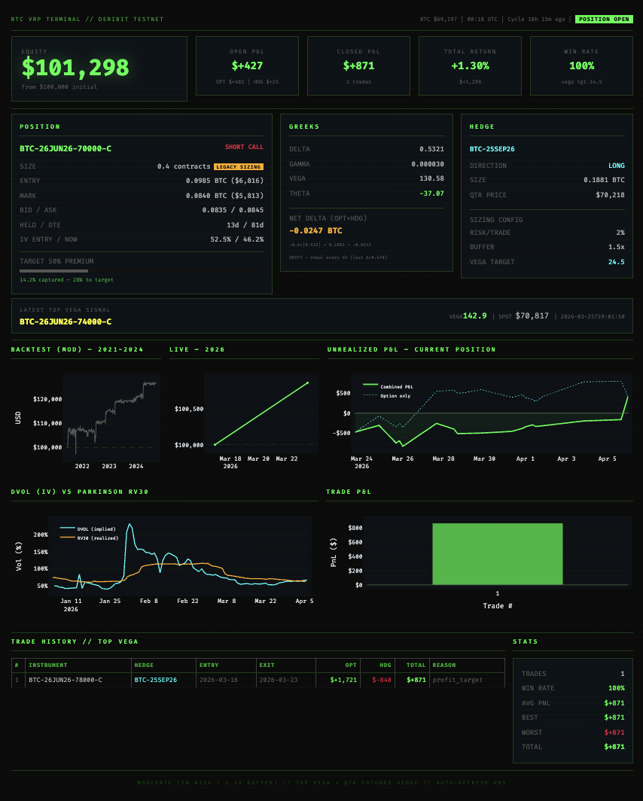
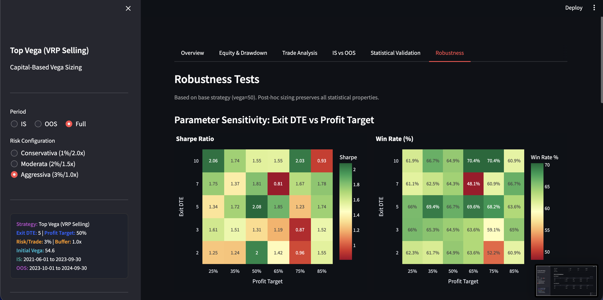

<div align="center">

# ₿ BTC Volatility Risk Premium
### Systematic Short-Volatility Strategy on Bitcoin Options

*Sell the highest-vega option daily on Deribit · hedge delta with quarterly futures · harvest the structural IV–RV spread*


-success)




**[🌀 Explore the interactive 3D vol surface →](https://raw.githack.com/giovannibrusco/btc-vrp-strategy/main/docs/interactive/vol_surface.html)**
*rotate · zoom · hover on real Deribit data, or open [`docs/interactive/vol_surface.html`](docs/interactive/vol_surface.html) locally after cloning*

</div>

---

## 📌 TL;DR

Bitcoin options are structurally expensive: implied volatility (Deribit DVOL) exceeded 30-day realized volatility (Parkinson) on **74% of trading days** (Jun 2021 – Sep 2024), with an average spread of **+6.2 vol points** (+7.4 against the realized vol of the following 30 days), roughly double the 3–4 points historically seen on the S&P 500.

This project harvests that premium with the **simplest strategy that survived a systematic elimination process**: sell the highest-vega delta-neutral option each day, hedge with quarterly futures, exit at 50% premium capture or DTE ≤ 5.

<div align="center">

</div>

## 📊 Results

|                  | 🟠 BTC In-Sample     | 🟠 BTC Out-of-Sample | 🔵 SPY (cross-asset) |
|------------------|:-------------------:|:-------------------:|:--------------------:|
| Period           | Jun 2021 – Sep 2023 | Oct 2023 – Sep 2024 | Jan 2010 – Dec 2023  |
| Trades           | 35                  | 10                  | 147                  |
| Win rate         | 65.7%               | 60.0%               | 66.0%                |
| **Sharpe** (per trade, annualized) | **1.75** | **1.52** | 0.79          |
| Sharpe (monthly MTM) | 1.29              | 1.16                | 0.71                 |
| Return (moderate)| +19.3%              | +7.0%               | +9.1%                |
| Max DD (MTM)     | −10.3%              | −2.3%               | −2.3%                |
| t-test (p, 1-sided) | 0.007            | 0.091               | n/a                  |

> 💪 The in-sample period **includes the 2022 bear market** (BTC −55% in a single quarter). Bootstrap 95% CI for IS Sharpe: [0.72, 2.73], P(Sharpe > 1) = 93%. The per-trade Sharpe is invariant across all sizing configurations. The monthly mark-to-market Sharpe also captures the swings while a position is open, so it is the more conservative figure.

<div align="center">

</div>

## 🔬 The Research Journey: Complexity That Didn't Survive

The final strategy is what remains after **five more sophisticated ideas were built, tested and rejected** with explicit quantitative criteria (the opposite of publication bias):

| # | Hypothesis | Verdict | Why |
|---|-----------|---------|-----|
| 1 | 🧮 RND–KDE gap scoring | ❌ Rejected | Demeaned gap vs PnL: β < 0, p = 0.37, no predictive power |
| 2 | ⏱️ Premium/DTE scoring | ❌ Rejected | **116% of profits** came from illiquid bid=0 options, a data artifact. Post-fix Sharpe: −0.24 |
| 3 | 🔀 Multi-position (3×) | ❌ Rejected | IS max drawdown −49.7%: positions crash together |
| 4 | 🚦 Regime filters (5 indicators) | ❌ Rejected | All correlations with trade PnL < 0.25 |
| 5 | 🛑 Stop loss | ❌ Rejected | At every level, kills more winner PnL than it saves on losers |
| 6 | 🏆 **Top Vega (final)** | ✅ **Survived** | Zero parameters, maximum VRP exposure per trade |

## ⚙️ Strategy Rules

```
SELECT   highest |vega| option, OTM, |delta| ≤ 0.50
EXECUTE  T+1 (signal at close → entry next day at bid)
HEDGE    delta-neutral via quarterly futures, daily rebalance (no funding)
EXIT     50% premium captured  OR  DTE ≤ 5
SIZE     vega_target = (equity × risk%) / (worst_loss_per_vega × buffer)
```

| Config | Risk/trade | Buffer | IS Return | IS Max DD | MC Median DD | MC P95 DD |
|--------------|:---:|:----:|:------:|:------:|:-----:|:-----:|
| 🟢 Conservative | 1% | 2.0× | +6.9%  | −3.9%  | −3.7% | −5.9% |
| 🟡 Moderate     | 2% | 1.5× | +19.3% | −10.3% | −9.7% | −15.1% |
| 🔴 Aggressive   | 3% | 1.0× | +47.8% | −22.6% | −21.4% | −31.9% |

Monte Carlo: 10,000 block-bootstrap paths of daily MTM returns: the realized drawdown sits at the simulated median (model validation), and **P(ruin) = 0%** in every configuration under the base scenario (0.23% for Aggressive under the stress scenario) ([`scripts/mc_drawdown_simulation.py`](scripts/mc_drawdown_simulation.py), fully reproducible, seed 2026).

<div align="center">

</div>

## 🌍 Why BTC and Not Equities?

Same strategy, zero re-optimization, applied to SPY options over 14 years: the option leg wins **82% of the time on both assets**, so the VRP itself is universal. The difference is entirely in the hedge economics:

|  | 🟠 BTC | 🔵 SPY |
|--|:---:|:---:|
| Option-only win rate | 82.9% | 82.3% |
| Option PnL / trade | +$858 | +$200 |
| **Hedge PnL / trade** | **+$298** ✅ | **−$129** ❌ |
| Entry IV | ~69% | ~16% |

High realized vol makes BTC gamma rebalancing *profitable* (+$771/trade even in flat markets); on SPY the same rebalancing costs more than it earns. **BTC is currently the only market where the premium is wide enough to pay for its own hedge.**

<div align="center">

</div>

## 🛡️ Robustness

- ✅ **Parameter grid**: all 30 profit-target × exit-DTE combinations profitable (Sharpe 0.81–2.08)
- ✅ **Outlier removal**: Sharpe stays positive with top-3 trades removed (1.25)
- ✅ **Cost stress**: profitable at 10× hedging costs
- ✅ **Bootstrap**: no confidence interval includes zero

<div align="center">

<br/>

</div>

## 🤖 Live Paper Trading

The full pipeline runs autonomously on **Deribit testnet** (cron, every 4h): real-time chain scoring → exit checks → delta rebalancing → order execution with dry-run fallback → state persistence.

```bash
python scripts/run_trader.py --once     # single cycle
python scripts/run_trader.py            # daemon mode
python scripts/run_trader.py --status   # check positions
```

<div align="center">

</div>

## 📈 Dashboards

Three Streamlit apps ship with the repo (pre-generated data included, so they work without the raw dataset):

| Dashboard | Command | What it shows |
|-----------|---------|---------------|
| 📖 Research story | `streamlit run dashboard/story.py` | Guided walkthrough of the VRP edge and rejected approaches |
| 🔍 Backtest explorer | `streamlit run dashboard/dashboard.py` | Equity curves, robustness heatmaps, IS/OOS validation |
| 📡 Live monitor | `streamlit run dashboard/live.py` | Real-time position, Greeks, hedge state, PnL |

<div align="center">

</div>

## 🚀 Quickstart

```bash
git clone https://github.com/giovannibrusco/btc-vrp-strategy.git
cd btc-vrp-strategy
pip install -r requirements.txt

# Dashboards work immediately (pre-generated data included)
streamlit run dashboard/story.py

# Full backtest requires raw data in Data/ (see Data section)
python scripts/run_backtest.py

# Live paper trading requires Deribit API credentials
cp .env.example .env   # then fill DERIBIT_CLIENT_ID / SECRET
```

## 🗂️ Repository Structure

```
├── 📁 src/               Core library: backtest engine, RND extraction, scoring, live trading
├── 📁 scripts/           Entry points: backtest, sensitivity, Monte Carlo, paper trader, figures
├── 📁 notebooks/         Research notebooks (signals & RND, sensitivity, money management, validation)
├── 📁 tests/             Statistical validation scripts
├── 📁 dashboard/         Streamlit apps (story, backtest explorer, live monitor)
├── 📁 dashboard_data/    Pre-generated results (committed: dashboards work out of the box)
├── 📁 thesis/            📜 MSc thesis (LaTeX, Italian): full writeup of the research
├── 📁 config/            Centralized parameters (params.yaml)
├── 📁 tools/             Data download utilities (Deribit, optionsDX)
└── 📁 docs/              Documentation, images, interactive charts
```

## 💾 Data

Raw option data (~5 GB) is **not** included:

- **BTC options**: Deribit historical EOD, Jun 2021 – Sep 2024 → `Data/Options_Historical_DataSet/`
- **BTC spot / futures / funding**: via `tools/` scripts (Deribit & Binance APIs)
- **SPY options**: [optionsDX](https://www.optionsdx.com/) EOD 2010–2023 → `SPY Options/extracted/`

`dashboard_data/` ships with the repo, so dashboards and the Monte Carlo script run out of the box.

## 🎓 Academic Context

This repository accompanies the MSc Finance thesis *"Il Volatility Risk Premium su Bitcoin: origini strutturali e strategie di raccolta tramite opzioni delta-neutrali"* (Università Cattolica del Sacro Cuore, Milan). The full LaTeX source lives in [`thesis/`](thesis/); every number in the thesis is reproducible from the code in this repo (the raw data must be downloaded separately, see [Data](#-data)).

## 📝 Errata

Errors found in the thesis after submission. The code and the figures in this README are corrected; the thesis files in [`thesis/`](thesis/) are left as defended.

- **VRP size (Ch. 1, 3, 10 and Figure 1.1).** The 30-day Parkinson realized vol was annualized with √252 instead of √365. Bitcoin trades every day of the year and DVOL is quoted on a 365-day basis, so realized vol was understated by about 17%. Corrected: IV > RV on **74%** of days (not 93%), average spread **+6.2** vol points (not +16.2), about twice the S&P 500 premium rather than four times. The premium is smaller but still clearly positive. Backtest results, Sharpe ratios, drawdowns and the regime correlations in Ch. 4 do not use this number and are unaffected (a constant scale factor does not change a correlation).
- **Out-of-sample win rate (Tables in Ch. 5 and 7).** 60.0% (6 winning trades out of 10), not 70.0%.
- **Sharpe ratio.** The thesis reports only the per-trade Sharpe (1.75 IS). On monthly mark-to-market returns it is 1.29 IS and 1.16 OOS; both are now shown above.

## ⚠️ Disclaimer

This project is for **educational and research purposes only**. It is not financial advice. Past performance does not guarantee future results. Options trading involves substantial risk of loss. The author is not responsible for any trading decisions based on this research.

## ©️ Copyright

© 2026 Giovanni Brusco. All rights reserved. The code and materials are published for reading and evaluation; no license is granted to copy, modify or redistribute them without written permission.
